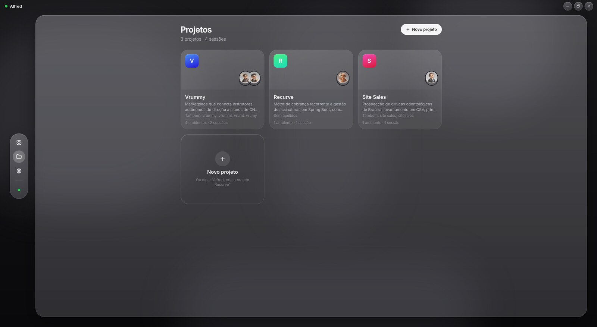
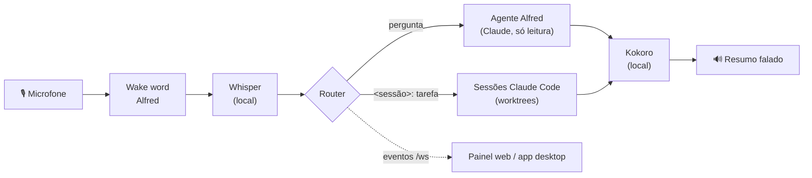

<div align="center">

# Alfred

**Assistente de voz para a rotina de dev.** Fala com você, pesquisa, lê e-mail e agenda, e comanda várias sessões do Claude Code em paralelo, cada uma com nome, projeto e worktree.

[](CHANGELOG.md)


</div>

```text
"Alfred, backend: cria o endpoint de cancelamento"
"Alfred, tenho e-mail importante hoje?"
"Alfred, manda o backend fazer a tarefa de reembolso"
```

## Funcionalidades

- 🎙️ **Hands-free:** wake word própria "Alfred", transcrição local (Whisper) e resposta falada (Kokoro), só com o resumo.
- 🧠 **Um ponto de entrada só:** o mesmo Alfred tira dúvidas, pesquisa na web, lê e-mail, agenda, arquivos e issues do GitHub.
- 🧑‍💻 **Sessões do Claude Code por voz:** sessões nomeadas em paralelo, presas a um projeto e a um ambiente (git worktree); delegue com "manda o backend fazer…".
- 🌿 **Projetos e worktrees:** ambientes espelham os worktrees; uma frase abre branch, worktree e sessão.
- 🔒 **Seguro por padrão:** o agente principal não tem shell nem edição; voz 100% local, raciocínio na nuvem.
- 🪟 **Painel e app desktop:** painel em vidro com orbe 3D que reage à voz, uso do plano em anéis, e app Tauri com tray e pílula flutuante.

## Telas

<table>
  <tr>
    <td width="50%"><br><sub><b>Sessão:</b> retrato, ambiente, modelo e effort</sub></td>
    <td width="50%"><br><sub><b>Projetos:</b> ambientes e sessões de cada um</sub></td>
  </tr>
  <tr>
    <td colspan="2"><br><sub><b>Configurações:</b> uso e limites do plano, modelos, sessões abertas e MCPs</sub></td>
  </tr>
</table>

## Como funciona



## Requisitos de máquina

- Linux ou macOS com microfone e alto-falante
- Python 3.11+ e [uv](https://docs.astral.sh/uv/)
- Node.js 20+ e pnpm
- Git 2.40+ (worktrees)
- Sistema: `libportaudio2`, `espeak-ng`
- Opcional: GPU NVIDIA com driver CUDA 12+ (Whisper em ~0,3 s em vez de ~6 s; cai para a CPU se a GPU estiver ocupada)
- [Claude Code](https://claude.com/claude-code) instalado e logado (`claude`)
- Para e-mail/agenda: credenciais Google

## Começando

```bash
sudo apt install libportaudio2
git clone <repo> alfred && cd alfred
make setup        # instala dependências (uv sync + pnpm install)
cp server/config.example.yaml server/config.yaml
make dev          # sobe voz + agente + API + painel (Vite)
```

A primeira execução baixa os modelos (Whisper ~1,6 GB, Kokoro ~330 MB). Diga **"Alfred"**, espere um instante e faça a pergunta. Se não acordar bem, `wakeword.model: hey_jarvis` no `config.yaml` volta ao modelo pronto.

Painel em http://localhost:5173: um orbe 3D que reage ao estado (ouvindo, transcrevendo, pensando, falando) e ao volume do microfone/voz. O botão **Transcrição** (ou tecla `T`) abre o histórico com o que foi ouvido, as tools usadas, o que foi falado, a resposta completa e os tempos (STT, 1ª fala, resposta); **Copiar** exporta em Markdown para avaliar.

App desktop (Linux/X11, [ADR 0012](docs/adr/0012-desktop-shell-tauri.md)): precisa do Rust e das libs do Tauri (`libwebkit2gtk-4.1-dev`, `libayatana-appindicator3-dev`, `librsvg2-dev`). Com o `make dev` rodando, `make dev-desktop` abre a janela; `make build-desktop` gera o binário que o `make install-launcher` passa a abrir no lugar do navegador. Fechar a janela deixa o Alfred no tray; minimizado ou no tray, uma pílula com a esfera e barras aparece no centro-baixo da tela enquanto ele ouve, pensa ou fala.

Eventos crus em tempo real (estado da voz, nível de áudio, progresso do agente):

```bash
websocat ws://localhost:8000/ws
```


## Documentação

| Documento | Conteúdo |
|---|---|
| [docs/SPEC.md](docs/SPEC.md) | Spec do produto (fonte da verdade) |
| [docs/REQUIREMENTS.md](docs/REQUIREMENTS.md) | Requisitos, regras de negócio e roadmap |
| [docs/ARCHITECTURE.md](docs/ARCHITECTURE.md) | Componentes, fluxo de um comando, dados, eventos, permissões |
| [docs/STACK.md](docs/STACK.md) | Tecnologias e o motivo de cada uma |
| [docs/DESIGN.md](docs/DESIGN.md) | Direção visual do painel e do app desktop |
| [docs/adr/](docs/adr/) | Decisões de arquitetura (ADRs) |
| [CONTRIBUTING.md](CONTRIBUTING.md) | Convenções, commits, PRs e releases |
| [CHANGELOG.md](CHANGELOG.md) | O que mudou em cada versão |

## Estrutura do repositório

```text
alfred/
├── server/        # Python 3.11+: voz + agentes + API (FastAPI)
├── apps/
│   ├── web/       # React + TypeScript + Vite (painel)
│   └── desktop/   # Tauri v2: janela do painel, pílula de voz, tray
├── docs/          # spec, requisitos, arquitetura, stack, ADRs
└── Makefile       # make dev = server + vite juntos
```

## Versões

[SemVer](https://semver.org/lang/pt-BR/) com tags `vX.Y.Z`; notas no [CHANGELOG.md](CHANGELOG.md) e nas [releases](https://github.com/NavesDev/AlfredAgent/releases). Como lançar: [CONTRIBUTING.md](CONTRIBUTING.md#versões-e-releases).

## Licença

A definir.
