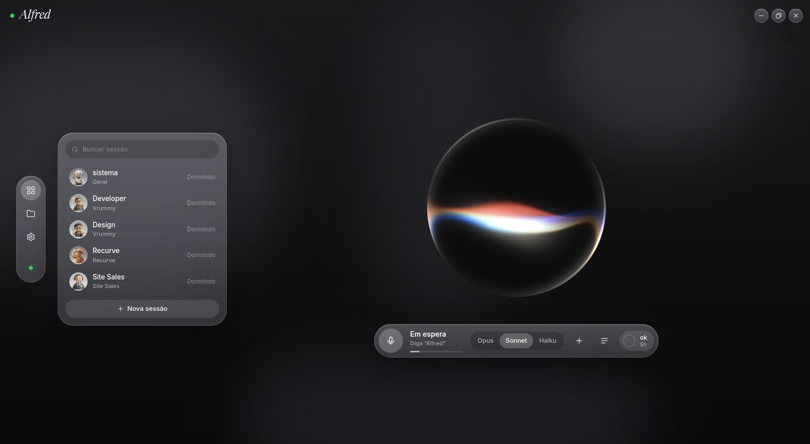
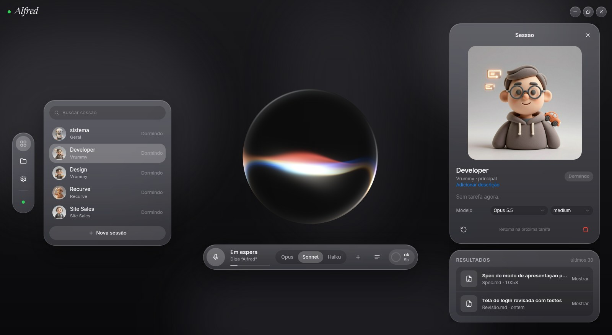
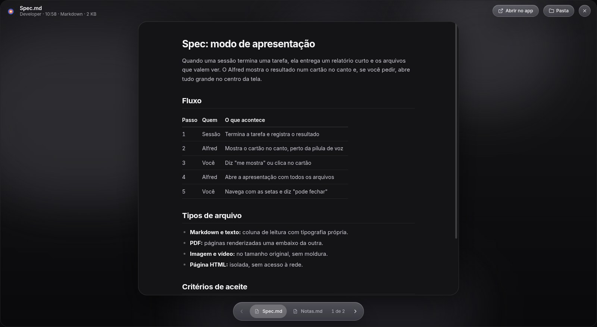
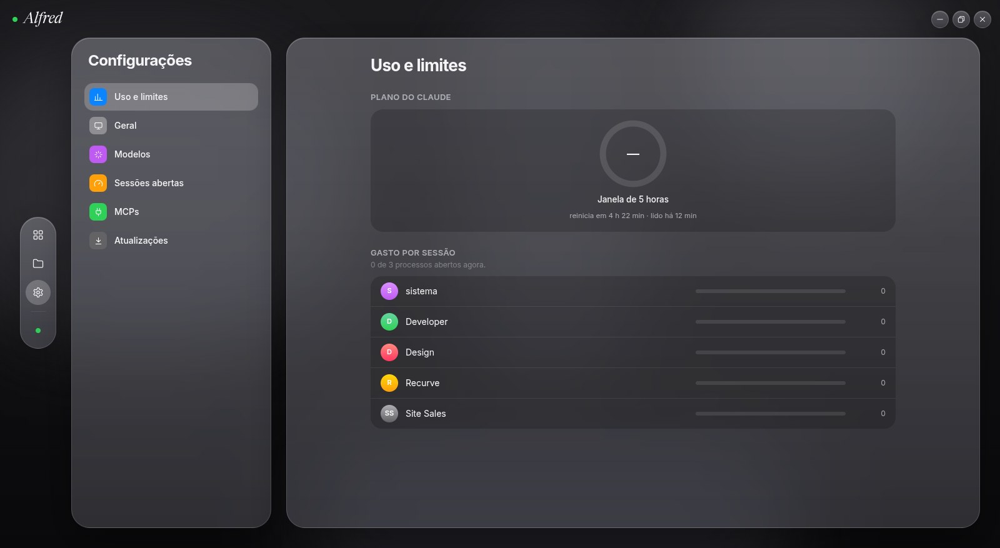
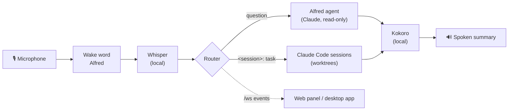

<div align="center">

# Alfred

**A voice assistant for the developer's day.** It talks back, searches the web, reads your mail and calendar, and runs several Claude Code sessions in parallel, each with its own name, project and worktree.

[](CHANGELOG.md)




</div>

Alfred listens in Brazilian Portuguese:

```text
"Alfred, backend: cria o endpoint de cancelamento"
"Alfred, tenho e-mail importante hoje?"
"Alfred, manda o backend fazer a tarefa de reembolso"
"Alfred, me mostra o que o Design fez"
```

## Features

- 🎙️ **Hands-free:** custom "Alfred" wake word, local transcription (Whisper) and spoken replies (Kokoro) that say only the summary.
- 🧠 **One entry point:** the same Alfred answers questions, searches the web and reads mail, calendar, files and GitHub issues.
- 🧑‍💻 **Claude Code sessions by voice:** named sessions in parallel, each tied to a project and a workspace (git worktree); delegate with "tell the backend to…".
- 🌿 **Projects and worktrees:** workspaces mirror your worktrees; one sentence opens a branch, a worktree and a session.
- 🖼️ **Presentations:** when a session finishes, its result (report, Markdown, PDF, images, video, pages) pops up in a corner card; say "me mostra" and Alfred opens it full size, with several files in one go.
- 🔒 **Safe by default:** the main agent has no shell or edit tools; voice stays 100% local, reasoning runs in the cloud.
- 🪟 **Panel and desktop app:** glass panel with a 3D orb that reacts to the voice, plan usage as rings, and a Tauri app with a tray and a floating voice pill.

## Screens

<table>
  <tr>
    <td width="50%"><br><sub><b>Session:</b> portrait, workspace, model, effort and its results</sub></td>
    <td width="50%"><br><sub><b>Projects:</b> workspaces and sessions of each one</sub></td>
  </tr>
  <tr>
    <td colspan="2"><br><sub><b>Presentation:</b> a session's result full size; switch files with the arrows or the bottom bar</sub></td>
  </tr>
  <tr>
    <td colspan="2"><br><sub><b>Settings:</b> plan usage and limits, models, open sessions and MCPs</sub></td>
  </tr>
</table>

## Presentations

Every Claude Code session can hand over what it made when a task ends: a short report plus the files worth seeing. Alfred shows it without getting in the way, then opens it big when you ask.

- **Corner card:** the floating voice pill turns into a small preview of the result; click it to expand. It leaves on its own.
- **Expanded view:** a separate window at 70% of the screen with the report and each file (Markdown, PDF, images, video, text, HTML), "Abrir no app" and "Pasta" buttons, and arrows (or ← →) to move between files.
- **By voice:** "me mostra o que o Design fez" opens a session's latest result; "apresenta o PDF do relatório" finds the files and opens them together; "pode fechar" closes it.
- **History:** each session keeps its last 30 results in the panel; "Mostrar" opens any of them again.
- **Local only:** result files are served to this computer only, and the card follows the position chosen in Settings → Geral.

## How it works



## Requirements

- Linux or macOS with a microphone and speakers
- Python 3.11+ and [uv](https://docs.astral.sh/uv/)
- Node.js 20+ and pnpm
- Git 2.40+ (worktrees)
- System packages: `libportaudio2`, `espeak-ng`
- Optional: NVIDIA GPU with CUDA 12+ drivers (Whisper in ~0.3 s instead of ~6 s; falls back to the CPU when the GPU is busy)
- [Claude Code](https://claude.com/claude-code) installed and logged in (`claude`)
- For mail and calendar: Google credentials

## Getting started

```bash
sudo apt install libportaudio2
git clone <repo> alfred && cd alfred
make setup        # installs dependencies (uv sync + pnpm install)
cp server/config.example.yaml server/config.yaml
make dev          # starts voice + agent + API + panel (Vite)
```

The first run downloads the models (Whisper ~1.6 GB, Kokoro ~330 MB). Say **"Alfred"**, wait a moment and ask. If it does not wake up reliably, `wakeword.model: hey_jarvis` in `config.yaml` switches to the stock model.

The panel runs at http://localhost:5173. **Transcript** (or the `T` key) opens the history: what was heard, the tools used, what was spoken, the full reply and the timings; **Copy** exports it as Markdown.

**Desktop app** (Linux/X11, [ADR 0012](docs/adr/0012-desktop-shell-tauri.md)): needs Rust and the Tauri libraries (`libwebkit2gtk-4.1-dev`, `libayatana-appindicator3-dev`, `librsvg2-dev`). With `make dev` running, `make dev-desktop` opens the window; `make build-desktop` builds the binary that `make install-launcher` opens instead of the browser. Closing the window keeps Alfred in the tray; while minimized or in the tray, a pill with the orb and bars shows at the bottom center of the screen when Alfred listens, thinks or speaks.

Raw real-time events (voice state, audio level, agent progress):

```bash
websocat ws://localhost:8000/ws
```

## Documentation

| Document | Contents |
|---|---|
| [docs/SPEC.md](docs/SPEC.md) | Product spec (source of truth) |
| [docs/REQUIREMENTS.md](docs/REQUIREMENTS.md) | Requirements, business rules and roadmap |
| [docs/ARCHITECTURE.md](docs/ARCHITECTURE.md) | Components, command flow, data, events, permissions |
| [docs/STACK.md](docs/STACK.md) | Technologies and why each one |
| [docs/DESIGN.md](docs/DESIGN.md) | Visual direction of the panel and the desktop app |
| [docs/adr/](docs/adr/) | Architecture decision records |
| [CONTRIBUTING.md](CONTRIBUTING.md) | Conventions, commits, PRs and releases |
| [CHANGELOG.md](CHANGELOG.md) | What changed in each version |

## Repository layout

```text
alfred/
├── server/        # Python 3.11+: voice + agents + API (FastAPI)
├── apps/
│   ├── web/       # React + TypeScript + Vite (panel)
│   └── desktop/   # Tauri v2: panel window, voice pill, tray
├── docs/          # spec, requirements, architecture, stack, ADRs
└── Makefile       # make dev = server + Vite together
```

## Releases

[SemVer](https://semver.org/) with `vX.Y.Z` tags, cut by [release-please](https://github.com/googleapis/release-please) from Conventional Commits. Notes in [CHANGELOG.md](CHANGELOG.md) and on the [releases page](https://github.com/NavesDev/AlfredAgent/releases).

Alfred updates itself: when a new tag comes out, the panel shows it with its notes, and **Atualizar** moves the checkout to that tag, reinstalls and restarts, rolling back if the install fails ([ADR 0013](docs/adr/0013-self-update-from-git-tags.md)). It needs a clean checkout on `main`.

## License

To be defined.
