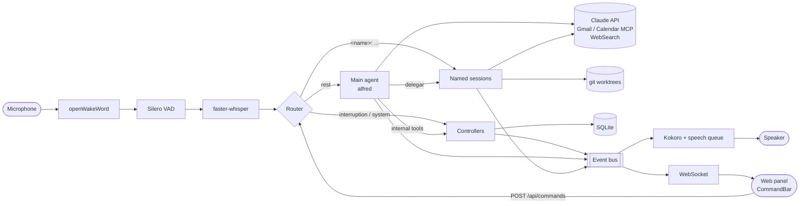
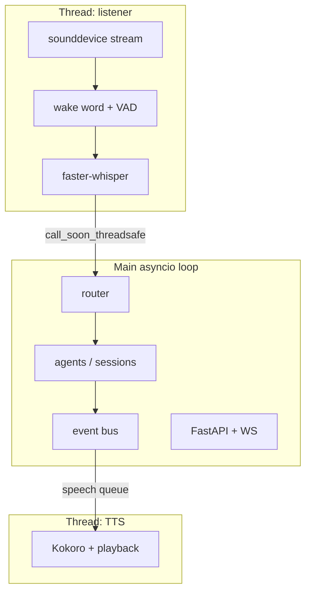
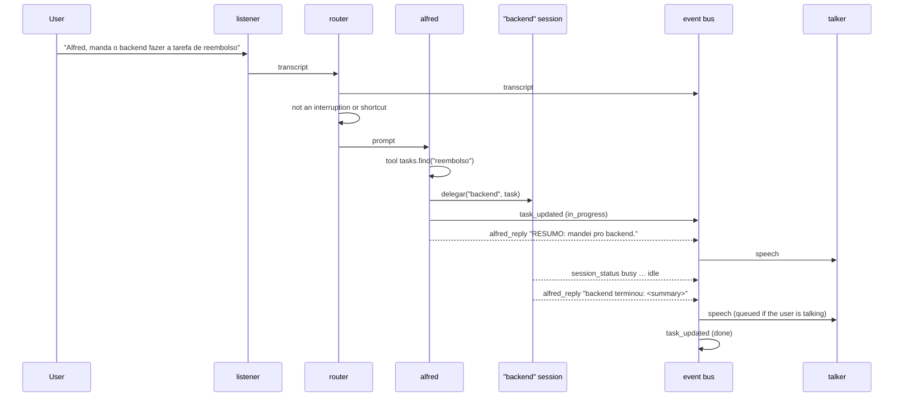
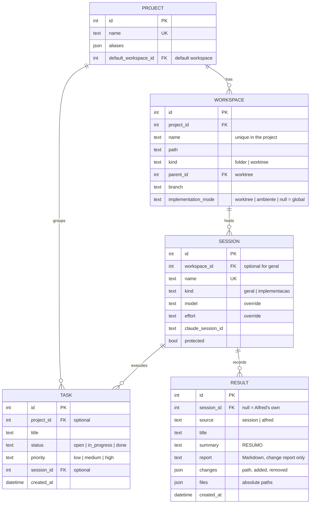
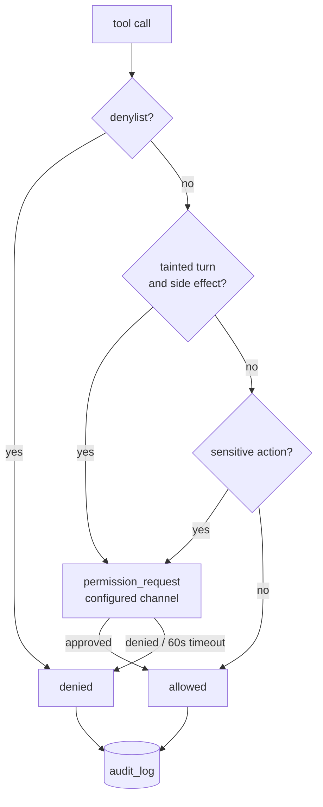

# Architecture

Alfred's technical view. Requirements in [REQUIREMENTS.md](REQUIREMENTS.md), technologies in [STACK.md](STACK.md).

## Overview

One Python process (asyncio) runs the voice loop, the agents and the API. Speech goes down the local chain to the router. System commands are resolved right there; the rest goes to the main agent or to a named session, which talk to Claude in the cloud and return only the summary line for Kokoro to speak.



Local: everything left of the cloud. Cloud: reasoning (Claude) and integrations (Gmail, Calendar, web).

## Server layers

| Layer | Responsibility | May import |
|---|---|---|
| `models/` | Data and SQLite. Knows nothing about voice or Claude | — |
| `infra/` | Outside world: microphone, speaker, Claude, git | `models` (types only) |
| `controllers/` | Decision logic. The only place that joins `models` with `infra` | `models`, `infra`, `events` |
| `api/` | Exposes controllers and events to the panel | `controllers`, `events` |
| `events.py` | In-memory bus (pub/sub) | — |
| `main.py` | Composition: starts the audio threads, the agents' loop and the API | everything |

No interfaces or extra layers. Swapping Whisper or Kokoro only touches `listener.py` or `talker.py`.

## Folder structure

```text
alfred/
├── server/
│   ├── main.py                # starts voice loop + API
│   ├── config.yaml            # local, not versioned (see config.example.yaml)
│   ├── pyproject.toml
│   ├── events.py              # in-memory event bus
│   ├── models/
│   │   ├── db.py
│   │   ├── project.py         # Project + Workspace
│   │   ├── session.py
│   │   └── task.py
│   ├── controllers/
│   │   ├── router.py          # interrupts + session-name shortcut
│   │   ├── sessions.py
│   │   ├── portraits.py       # portrait queue, files under data/portraits
│   │   ├── projects.py
│   │   ├── tasks.py
│   │   └── updates.py         # release check + self-update (ADR 0013)
│   ├── infra/
│   │   ├── audio/
│   │   │   ├── device.py      # GPU on demand, CPU fallback
│   │   │   ├── listener.py    # wake word + VAD + Whisper
│   │   │   └── talker.py      # Kokoro + speech queue
│   │   ├── claude/
│   │   │   ├── alfred.py      # main agent
│   │   │   ├── session.py     # coding sessions
│   │   │   ├── portrait.py    # one-shot agent that paints session portraits
│   │   │   ├── permissions.py # permission gates
│   │   │   └── tools.py       # internal tools for Alfred
│   │   └── git.py             # git worktree add/remove/list, state, watcher of .git/worktrees
│   └── api/
│       ├── app.py             # FastAPI + serves the web build
│       ├── routes/            # projects, sessions, tasks, confirmations, commands
│       └── ws.py              # pushes events to the web app
├── apps/
│   ├── web/                   # React + TypeScript + Vite
│   └── desktop/               # Tauri v2 shell: main window, overlay, tray (ADR 0012)
├── docs/
└── Makefile
```

## Threads and concurrency



- Capture and wake word are always on, at near-zero CPU cost.
- Whisper runs in its own thread (`stt`). The wake word already loads the model on the GPU; on a 400 ms pause it transcribes the audio so far, and that guess becomes the command if nobody speaks again. The microphone is ignored while the final text is awaited.
- Whisper and Kokoro use the GPU on demand and fall back to the CPU when it is busy (`infra/audio/device.py`, [ADR 0010](adr/0010-voice-models-on-demand-gpu.md)).
- Kokoro consumes a priority speech queue; barge-in clears the queue and stops playback.
- Interruptions ("para") match in the listener/router itself before any long `await`, to act in milliseconds.

## Flow of a command



## Routing

Evaluation order in `controllers/router.py`:

1. **Interruptions** (regex): `para`, `<session>, para`, `para tudo`. They act even when everything is busy.
2. **System commands** (fixed grammar, no tokens): focus, status, list, close a session, etc. Those that do not match safely fall to the main agent, which has the same tools.
3. **Explicit shortcut**: `<name>:` or `<name>,` at the start, where `<name>` matches a session name/alias (rapidfuzz ≥ ~85). Goes straight to the session.
4. **Main agent**: everything else.

A busy session never gets two prompts at once: each session has a FIFO queue. The router publishes the "tá ocupado, coloquei na fila" notice.

## Agents

### Main agent (`alfred`)

- Fixed session, not tied to a repository.
- Tools: WebSearch, WebFetch, Read, Glob, Grep, Gmail MCP, Calendar MCP and the in-process MCP in `infra/claude/tools.py` (projects, sessions, worktrees, tasks, `delegar`, `ver_ambiente`, `iniciar_feature`).
- **No Bash, Edit or Write.** Whoever reads external content never runs commands.
- Reads the home (`cwd`), except secret files; the `guard_local_paths` hook denies paths outside it. Questions and checks it answers by reading; implementation and large analysis go to a session ([ADR 0011](adr/0011-main-agent-local-read.md)).
- Tasks on the computer go through the `delegar` tool to the `sistema` session, which has Bash and auto mode, without mail or web ([ADR 0006](adr/0006-system-session-for-computer-tasks.md)).
- Each agent kind (`AgentKind` in `infra/claude/agents.py`) gets its own `delegar_<kind>` tool; Alfred creates, lists, clears and deletes sessions by voice ([ADR 0007](adr/0007-polymorphic-agent-kinds.md)).
- Until phase 5: Claude Code's auto mode decides permissions, with reads allowed, no Bash/Edit/Write and no URLs other than http/https ([ADR 0005](adr/0005-main-agent-auto-mode.md)).
- Sonnet by default; simple questions may go to Haiku.
- Knows the focused session and the current project (injected into the context).
- One conversation per day: the `alfred` session's `claude_session_id` rotates daily.
- Persistent client (`ClaudeSDKClient`): the CLI stays open between questions and reopens when the day turns or after an error.

### Named sessions

- One Agent SDK instance per session, with `cwd` = the workspace path (or the home, for `geral` with no workspace).
- Kinds: `geral` (shell and files, isolated) and `implementacao` (full Claude Code harness, tied to a workspace; [ADR 0008](adr/0008-implementation-agent-full-harness.md)). Model and effort come from `agent_settings`, with a per-session override.
- Native subagents (`TaskStarted/Progress/NotificationMessage`) become `subagent_*` events; messages with `parent_tool_use_id` do not count as session activity.
- The phase (`exploring`, `editing`, `running`) comes from the tool name (`activity.phase_of`).
- Claude Code's auto mode + the `canUseTool` gate in `permissions.py`.
- `system_prompt` requires starting with `RESUMO:` (up to 2 sentences, no code or long paths), spoken as soon as it arrives.
- `claude_session_id` persisted for resume after a restart.
- Portrait: a one-question agent, with only the user's MCPs, paints the session's picture on creation and at boot; the favorite generator (`image_mcp`) narrows the tools ([ADR 0009](adr/0009-session-portraits-via-mcp.md)).
- Slots: `max_active_sessions` counts open `claude` processes. With no free slot, the session idle the longest closes its process; if all are working, the task waits. A session idle for `idle_minutes` closes on its own and resumes through `claude_session_id`.

## Data model



Settings live in `agent_settings` (model and effort per kind: `alfred`, `geral`, `implementacao`) and `app_settings` (`max_active_sessions`, `idle_minutes`, `mcp_disabled`, `image_mcp`, `implementation_mode`, `overlay_position`); `config.yaml` only seeds them the first time. Session status and queues live in memory.

Each session keeps its last 30 results; older rows are deleted (files stay on disk). Results come from `APRESENTAR:`/`GUARDAR:` lines in a session's final reply or from Alfred's `apresentar` tool ([ADR 0014](adr/0014-results-presentation.md)).

Workspaces mirror git worktrees: `Projects.watch_worktrees` watches each repo's `.git/worktrees/` through inotify and syncs only the repo that changed; at startup it syncs everything once.

Planned auxiliary tables: `audit_log` (every tool call), `confirmation` (pending/answered requests), `session_summary` (last `RESUMO:` per session).

## Event bus

`events.py` is an in-memory pub/sub. Controllers and agents publish; `talker` and `ws.py` consume. Voice and screen stay in parity without duplicated logic.

| Event | Main payload | Consumers |
|---|---|---|
| `transcript` | text, source (voice/panel) | ws |
| `alfred_reply` | session, summary, full text | talker (summary only), ws |
| `alfred_cleared` | — (the day's conversation forgotten) | ws |
| `session_created` | session snapshot | ws |
| `session_status` | session snapshot (status, task, activity, queue, tokens, last summary) | ws |
| `session_cleared` | session snapshot | ws |
| `session_deleted` | name | ws |
| `subagent_started` / `_progress` / `_finished` | session, id, kind, description, last tool, status | ws |
| `project_created` / `_updated` / `_deleted` | project with workspaces (or id) | ws |
| `settings_updated` | settings | ws |
| `mcp_servers_seen` | session, names of the loaded MCPs | settings (screen suggestions) |
| `portrait_updated` | session | sessions (republishes the status) |
| `task_updated` | task | ws |
| `permission_request` | id, session, action, description, channel | talker, ws |
| `permission_resolved` | id, approved, channel | ws |
| `result_created` | result | ws (session history) |
| `result_presented` | result, mode (`card` / `ampliado`) | ws (overlay card, panel card, viewer) |
| `presentation_closed` | — | ws |
| `update_status` | update snapshot (current, latest, notes, status, last result) | ws |

## Errors

Layered exceptions, all in `server/errors.py`:

```text
AlfredError
├── ConfigError        # invalid config.yaml              → fatal at startup
├── DependencyError    # claude CLI, microphone, models   → fatal at startup
├── AudioError         # capture/STT/TTS failure          → recoverable
└── AgentError         # Agent SDK failure/timeout        → recoverable
```

Rules:

- **`infra` translates:** an external library exception becomes the layer's exception with `raise XError(...) from e`. No `except Exception` swallowing errors.
- **`controllers` decides:** catches `AudioError`/`AgentError` at the turn boundary, publishes `error` on the bus, speaks the short message and goes back to `idle`.
- **`main` exits:** `ConfigError`/`DependencyError` print the message and exit with code 1.
- **Fail-fast:** everything that can fail is checked at startup, before opening the microphone: valid config, `claude` on the `PATH`, audio device, models (Whisper, Kokoro, wake word). Nothing is loaded on demand on the first command.
- An unexpected exception inside an audio thread: logged with the traceback, `error` published, the thread keeps going. In the main loop, it brings the process down.

## Permissions



- **Denylist:** `sudo`, `rm -rf` outside the worktree, writes outside the workspace.
- **Sensitive:** push, deleting a file, installing a dependency, sending mail, changing the calendar.
- **Tainted turn:** if the turn read mail or the web, any side effect needs confirmation (defense against prompt injection).
- **Channels:** `voice`, `key`, `web`, `voice+key`, configurable per action. A spoken "yes" does not prove it was you, so critical actions use `key`.
- A waiting session is `waiting_permission`. Confirmation can come by voice or through `POST /api/confirmations/{id}`.

## API

| Route | Use |
|---|---|
| `GET/POST /api/projects`, `GET/PATCH/DELETE /api/projects/{id}` | Projects and workspaces |
| `POST /api/projects/{id}/workspaces`, `POST /api/projects/{id}/worktrees`, `PATCH /api/workspaces/{id}`, `DELETE /api/workspaces/{id}?force=` | Folders and worktrees (PATCH changes the description) |
| `POST /api/alfred/clear` | Forgets Alfred's conversation of the day (waits for the reply in progress) |
| `GET/POST /api/sessions`, `PATCH /api/sessions/{name}`, `POST …/clear`, `DELETE …` | Sessions |
| `GET/POST /api/sessions/{name}/portrait` | Session portrait (POST paints it again) |
| `GET/PUT /api/settings` | Model and effort per kind, limits, disabled MCPs, favorite image generator, overlay position preset |
| `GET /api/results?session=`, `GET /api/results/{id}` | A session's results (newest first, up to 30) and one result |
| `GET /api/results/{id}/files/{index}` | A result's file; loopback clients only (403 otherwise), 410 when it no longer exists |
| `POST /api/results/{id}/present`, `POST /api/presentation/close` | Shows a result (`card` or `ampliado`) and closes what is shown |
| `GET/POST/PATCH /api/tasks` | Tasks |
| `GET /api/confirmations`, `POST /api/confirmations/{id}` | Pending confirmations |
| `POST /api/commands` | Text into the same router as the voice |
| `GET /api/update`, `POST /api/update/check`, `POST /api/update/apply` | Release check and self-update ([ADR 0013](adr/0013-self-update-from-git-tags.md)) |
| `WS /ws` | Bus event stream |

In dev, Vite proxies `/api` and `/ws` to the server. In production, FastAPI serves `dist/` on the same port.

## Web (`apps/web`)

Organized by feature; each feature repeats the `pages/`, `components/`, `hooks/` skeleton (only what it needs).

```text
apps/web/src/
├── main.tsx
├── App.tsx                      # layout + routes + global ConfirmDialog
├── api/                         # client.ts, schema.ts (generated), events.ts
├── pages/OverlayPage.tsx        # desktop overlay: composes assistant (pill) and results (card)
├── features/
│   ├── sessions/  projects/  settings/  tasks/  confirmations/
│   ├── activity/  command/  dashboard/  results/
├── components/                  # layout/, shared controls
├── hooks/useEvents.ts           # WebSocket → updates the cache
├── lib/
└── styles/globals.css
```

Rules:

- All API access lives in the feature hooks (TanStack Query). Components only call the hook and render.
- A feature imports from `api/`, `components/`, `hooks/`, `lib/`, never from another feature. Exception: `dashboard`.
- A component used by two features moves up to `components/`. A feature-specific type goes in `types.ts` at its root.
- No global state manager: server state in TanStack Query, the rest in `useState`.

## Decisions

See [adr/](adr/).
