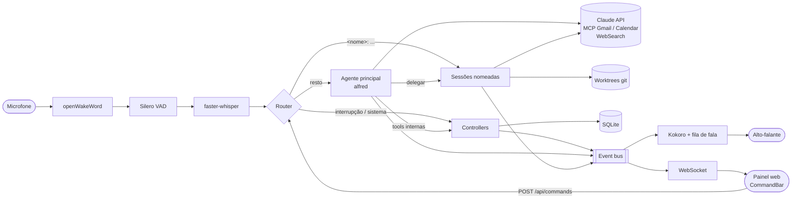
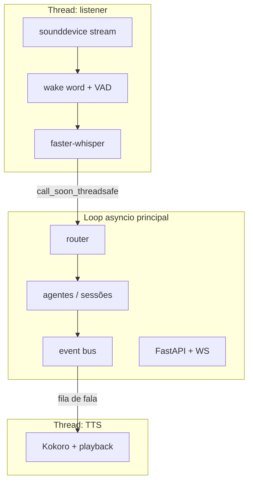
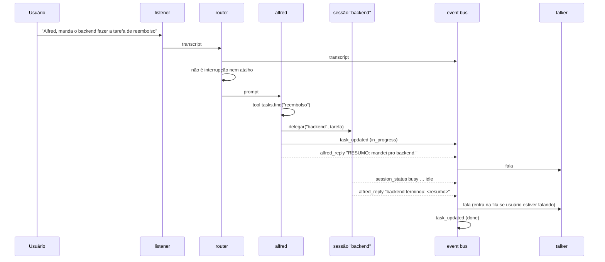
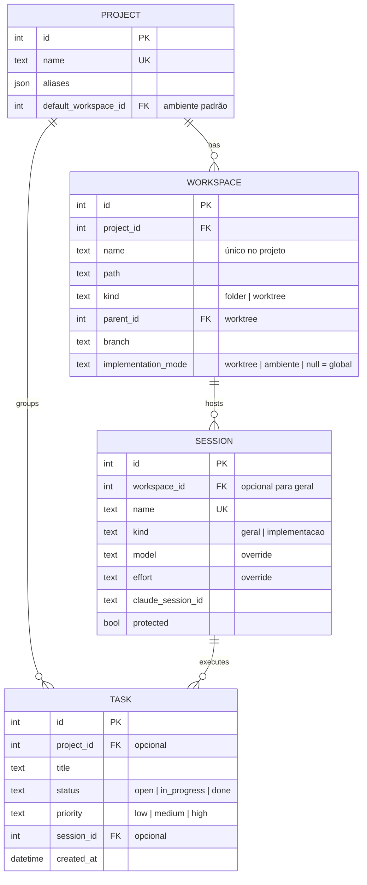
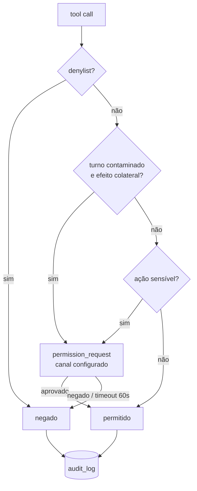

# Arquitetura

Visão técnica do Alfred. Requisitos em [REQUIREMENTS.md](REQUIREMENTS.md), tecnologias em [STACK.md](STACK.md).

## Visão geral

Um processo Python (asyncio) roda o loop de voz, os agentes e a API. A fala desce pela cadeia local até o roteador. Comandos de sistema são resolvidos ali mesmo; o resto vai para o agente principal ou para uma sessão nomeada, que conversam com o Claude na nuvem e devolvem só a linha de resumo para o Kokoro falar.



Local: tudo à esquerda da nuvem. Nuvem: raciocínio (Claude) e integrações (Gmail, Calendar, web).

## Camadas do server

| Camada | Responsabilidade | Pode importar |
|---|---|---|
| `models/` | Dados e SQLite. Não sabe nada de voz nem de Claude | — |
| `infra/` | Mundo externo: microfone, alto-falante, Claude, git | `models` (só tipos) |
| `controllers/` | Lógica de decisão. Único lugar que junta `models` com `infra` | `models`, `infra`, `events` |
| `api/` | Expõe controllers e eventos ao painel | `controllers`, `events` |
| `events.py` | Bus em memória (pub/sub) | — |
| `main.py` | Composição: sobe threads de áudio, loop dos agentes e API | tudo |

Sem interfaces nem camadas extras. Trocar Whisper ou Kokoro é mexer só em `listener.py` ou `talker.py`.

## Estrutura de pastas

```text
alfred/
├── server/
│   ├── main.py                # starts voice loop + API
│   ├── config.yaml            # local, not versioned (see config.example.yaml)
│   ├── pyproject.toml
│   ├── events.py              # in-memory event bus
│   ├── models/
│   │   ├── db.py
│   │   ├── project.py         # Project + Workspace
│   │   ├── session.py
│   │   └── task.py
│   ├── controllers/
│   │   ├── router.py          # interrupts + session-name shortcut
│   │   ├── sessions.py
│   │   ├── portraits.py       # portrait queue, files under data/portraits
│   │   ├── projects.py
│   │   └── tasks.py
│   ├── infra/
│   │   ├── audio/
│   │   │   ├── device.py      # GPU on demand, CPU fallback
│   │   │   ├── listener.py    # wake word + VAD + Whisper
│   │   │   └── talker.py      # Kokoro + speech queue
│   │   ├── claude/
│   │   │   ├── alfred.py      # main agent
│   │   │   ├── session.py     # coding sessions
│   │   │   ├── portrait.py    # one-shot agent that paints session portraits
│   │   │   ├── permissions.py # permission gates
│   │   │   └── tools.py       # internal tools for Alfred
│   │   └── git.py             # git worktree add/remove/list, estado, watcher de .git/worktrees
│   └── api/
│       ├── app.py             # FastAPI + serves the web build
│       ├── routes/            # projects, sessions, tasks, confirmations, commands
│       └── ws.py              # pushes events to the web app
├── apps/
│   ├── web/                   # React + TypeScript + Vite
│   └── desktop/               # Tauri v2 shell: main window, overlay, tray (ADR 0012)
├── docs/
└── Makefile
```

## Threads e concorrência



- Captura e wake word ficam sempre ligados, com custo quase zero de CPU.
- O Whisper roda numa thread própria (`stt`). A wake word já carrega o modelo na GPU; numa pausa de 400 ms ele transcreve o áudio até ali, e esse palpite vira o comando se ninguém voltar a falar. O microfone é ignorado enquanto o texto final é aguardado.
- Whisper e Kokoro usam a GPU sob demanda e caem para a CPU com ela ocupada (`infra/audio/device.py`, [ADR 0010](adr/0010-voice-models-on-demand-gpu.md)).
- O Kokoro consome uma fila de fala com prioridade; barge-in limpa a fila e para o playback.
- Interrupções ("para") são casadas no próprio listener/router antes de qualquer `await` longo, para agir em milissegundos.

## Fluxo de um comando



## Roteamento

Ordem de avaliação no `controllers/router.py`:

1. **Interrupções** (regex): `para`, `<sessão>, para`, `para tudo`. Agem mesmo com tudo ocupado.
2. **Comandos de sistema** (gramática fixa, sem token): foco, status, listar, fechar sessão etc. Os que não casarem com segurança caem no agente principal, que tem as mesmas tools.
3. **Atalho explícito**: `<nome>:` ou `<nome>,` no início, onde `<nome>` casa com nome/apelido de sessão (rapidfuzz ≥ ~85). Vai direto para a sessão.
4. **Agente principal**: todo o resto.

Sessão ocupada não recebe dois prompts ao mesmo tempo: cada sessão tem uma fila FIFO. O router publica o aviso "tá ocupado, coloquei na fila".

## Agentes

### Agente principal (`alfred`)

- Sessão fixa, não presa a repositório.
- Tools: WebSearch, WebFetch, Read, Glob, Grep, MCP Gmail, MCP Calendar e o MCP in-process de `infra/claude/tools.py` (projetos, sessões, worktrees, tarefas, `delegar`, `ver_ambiente`, `iniciar_feature`).
- **Sem Bash, Edit e Write.** Quem lê conteúdo externo nunca executa comando.
- Lê a home (`cwd`), menos arquivos secretos; o hook `guard_local_paths` nega caminho fora dela. Pergunta e verificação ele responde lendo; implementação e análise grande vão para sessão ([ADR 0011](adr/0011-main-agent-local-read.md)).
- Tarefas no computador vão pela tool `delegar` para a sessão `sistema`, com Bash e auto mode, sem e-mail nem web ([ADR 0006](adr/0006-system-session-for-computer-tasks.md)).
- Cada tipo de agente (`AgentKind` em `infra/claude/agents.py`) gera sua tool `delegar_<tipo>`; o Alfred cria, lista, limpa e apaga sessões por voz ([ADR 0007](adr/0007-polymorphic-agent-kinds.md)).
- Até a fase 5: auto mode do Claude Code decide as permissões, com leituras liberadas, sem Bash/Edit/Write e sem URLs fora de http/https ([ADR 0005](adr/0005-main-agent-auto-mode.md)).
- Modelo Sonnet por padrão; perguntas simples podem cair no Haiku.
- Conhece a sessão em foco e o projeto atual (injetados no contexto).
- Uma conversa por dia: o `claude_session_id` da sessão `alfred` rotaciona diariamente.
- Cliente persistente (`ClaudeSDKClient`): o CLI fica aberto entre perguntas e é reaberto quando o dia vira ou após erro.

### Sessões nomeadas

- Uma instância do Agent SDK por sessão, com `cwd` = path do ambiente (ou a home, para `geral` sem ambiente).
- Tipos: `geral` (shell e arquivos, isolada) e `implementacao` (harness completo do Claude Code, preso a um ambiente; [ADR 0008](adr/0008-implementation-agent-full-harness.md)). Modelo e effort vêm de `agent_settings`, com override por sessão.
- Subagentes nativos (`TaskStarted/Progress/NotificationMessage`) viram eventos `subagent_*`; as mensagens com `parent_tool_use_id` não contam como atividade da sessão.
- A fase (`exploring`, `editing`, `running`) vem do nome da tool (`activity.phase_of`).
- Auto mode do Claude Code + gate `canUseTool` do `permissions.py`.
- `system_prompt` exige começar com `RESUMO:` (até 2 frases, sem código nem caminhos longos), falado assim que chega.
- `claude_session_id` persistido para resume após reinício.
- Retrato: um agente de uma pergunta, só com os MCPs do usuário, gera a foto da sessão ao criar e no boot; o gerador favorito (`image_mcp`) restringe as tools ([ADR 0009](adr/0009-session-portraits-via-mcp.md)).
- Vagas: `max_active_sessions` conta processos `claude` abertos. Sem vaga, a sessão ociosa há mais tempo fecha o processo; se todas trabalham, a tarefa espera. Sessão ociosa por `idle_minutes` fecha sozinha e retoma pelo `claude_session_id`.

## Modelo de dados



Configurações em `agent_settings` (modelo e effort por tipo: `alfred`, `geral`, `implementacao`) e `app_settings` (`max_active_sessions`, `idle_minutes`, `mcp_disabled`, `image_mcp`, `implementation_mode`); o `config.yaml` só semeia na primeira vez. Status e fila das sessões ficam em memória.

Ambientes espelham os worktrees do git: `Projects.watch_worktrees` observa por inotify o `.git/worktrees/` de cada repo e sincroniza só o repo que mudou; ao iniciar, sincroniza tudo uma vez.

Tabelas auxiliares previstas: `audit_log` (toda tool call), `confirmation` (pedidos pendentes/respondidos), `session_summary` (último `RESUMO:` por sessão).

## Event bus

`events.py` é um pub/sub em memória. Controllers e agentes publicam; `talker` e `ws.py` consomem. Voz e tela ficam em paridade sem duplicar lógica.

| Evento | Payload principal | Consumidores |
|---|---|---|
| `transcript` | texto, origem (voz/painel) | ws |
| `alfred_reply` | sessão, resumo, texto completo | talker (só resumo), ws |
| `alfred_cleared` | — (conversa do dia esquecida) | ws |
| `session_created` | snapshot da sessão | ws |
| `session_status` | snapshot da sessão (status, tarefa, atividade, fila, tokens, último resumo) | ws |
| `session_cleared` | snapshot da sessão | ws |
| `session_deleted` | nome | ws |
| `subagent_started` / `_progress` / `_finished` | sessão, id, tipo, descrição, última tool, status | ws |
| `project_created` / `_updated` / `_deleted` | projeto com ambientes (ou id) | ws |
| `settings_updated` | configurações | ws |
| `mcp_servers_seen` | sessão, nomes dos MCPs carregados | settings (sugestões da tela) |
| `portrait_updated` | sessão | sessions (republica o status) |
| `task_updated` | tarefa | ws |
| `permission_request` | id, sessão, ação, descrição, canal | talker, ws |
| `permission_resolved` | id, aprovado, canal | ws |

## Erros

Exceções em camadas, todas em `server/errors.py`:

```text
AlfredError
├── ConfigError        # config.yaml inválido            → fatal na inicialização
├── DependencyError    # CLI claude, microfone, modelos   → fatal na inicialização
├── AudioError         # falha em captura/STT/TTS         → recuperável
└── AgentError         # falha/timeout no Agent SDK       → recuperável
```

Regras:

- **`infra` traduz:** exceção de biblioteca externa vira a exceção da camada com `raise XError(...) from e`. Nada de `except Exception` engolindo erro.
- **`controllers` decide:** captura `AudioError`/`AgentError` no limite do turno, publica `error` no bus, fala a mensagem curta e volta a `idle`.
- **`main` encerra:** `ConfigError`/`DependencyError` imprimem a mensagem e saem com código 1.
- **Fail-fast:** tudo que pode falhar é verificado na inicialização, antes de abrir o microfone: config válido, `claude` no `PATH`, dispositivo de áudio, modelos (Whisper, Kokoro, wake word) carregados de forma eager. Nada é carregado sob demanda no primeiro comando.
- Exceção inesperada dentro de thread de áudio: loga com traceback, publica `error`, a thread segue. No loop principal, derruba o processo.

## Permissões



- **Denylist:** `sudo`, `rm -rf` fora do worktree, escrita fora do ambiente.
- **Sensíveis:** push, apagar arquivo, instalar dependência, enviar e-mail, mexer na agenda.
- **Turno contaminado:** se o turno leu e-mail ou web, qualquer efeito colateral exige confirmação (defesa contra prompt injection).
- **Canais:** `voice`, `key`, `web`, `voice+key`, configuráveis por ação. Um "pode" falado não prova que foi você, por isso ações críticas usam `key`.
- Sessão aguardando fica `waiting_permission`. Confirmação pode vir por voz ou por `POST /api/confirmations/{id}`.

## API

| Rota | Uso |
|---|---|
| `GET/POST /api/projects`, `GET/PATCH/DELETE /api/projects/{id}` | Projetos e ambientes |
| `POST /api/projects/{id}/workspaces`, `POST /api/projects/{id}/worktrees`, `PATCH /api/workspaces/{id}`, `DELETE /api/workspaces/{id}?force=` | Pastas e worktrees (PATCH muda a descrição) |
| `POST /api/alfred/clear` | Esquece a conversa do dia do Alfred (espera a resposta em andamento) |
| `GET/POST /api/sessions`, `PATCH /api/sessions/{name}`, `POST …/clear`, `DELETE …` | Sessões |
| `GET/POST /api/sessions/{name}/portrait` | Retrato da sessão (POST gera de novo) |
| `GET/PUT /api/settings` | Modelos e effort por tipo, limites, MCPs desligados, gerador de imagem favorito |
| `GET/POST/PATCH /api/tasks` | Tarefas |
| `GET /api/confirmations`, `POST /api/confirmations/{id}` | Confirmações pendentes |
| `POST /api/commands` | Texto para o mesmo router da voz |
| `WS /ws` | Stream de eventos do bus |

Em dev, o Vite faz proxy de `/api` e `/ws` para o server. Em produção, o FastAPI serve o `dist/` na mesma porta.

## Web (`apps/web`)

Organizado por feature; cada feature repete o esqueleto `pages/`, `components/`, `hooks/` (só o que precisa).

```text
apps/web/src/
├── main.tsx
├── App.tsx                      # layout + routes + global ConfirmDialog
├── api/                         # client.ts, schema.ts (generated), events.ts
├── features/
│   ├── sessions/  projects/  settings/  tasks/  confirmations/
│   ├── activity/  command/  dashboard/
├── components/                  # ui/ (shadcn), layout/
├── hooks/useEvents.ts           # WebSocket → updates the cache
├── lib/
└── styles/globals.css
```

Regras:

- Todo acesso à API fica nos hooks da feature (TanStack Query). Componentes só chamam o hook e renderizam.
- Feature importa de `api/`, `components/`, `hooks/`, `lib/`, nunca de outra feature. Exceção: `dashboard`.
- Componente usado por duas features sobe para `components/`. Tipo específico de feature vai em `types.ts` na raiz dela.
- Sem gerenciador de estado global: servidor no TanStack Query, o resto em `useState`.

## Decisões

Ver [adr/](adr/).
